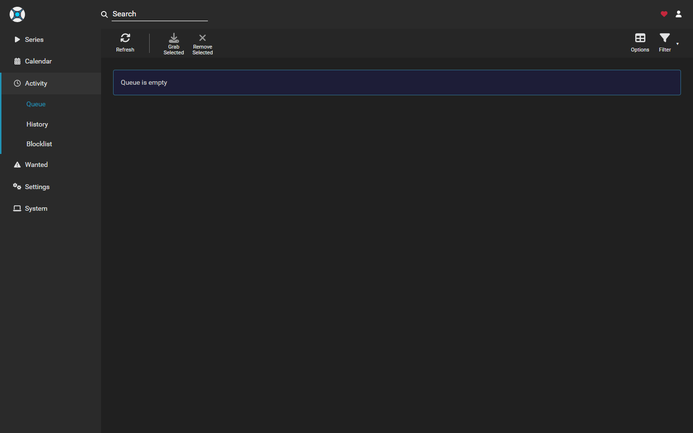
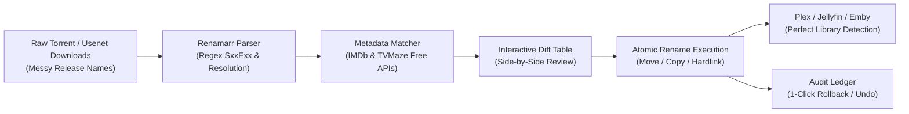

<div align="center">

# ⚡ Renamarr

### Next-Gen Interactive Media Renamer & Organizer for Movies & TV Shows
**The free, modern, web-based alternative to FileBot for Plex, Jellyfin & Emby.**

<p align="center">
  
  
  
  
  
  
</p>

</div>

---

## 📸 Production Preview

*Automated media processing queue: scanning release filenames, resolving canonical episode titles, and preparing structured target paths.*



---

## 🚀 Overview

**Renamarr** is a self-hosted, interactive media organizer that recursively scans your local drives or network shares (`\\nas\media`, SMB, NFS), matches movies and TV shows against **IMDb** and **TVMaze**, and renames/organizes them into strict **Plex / Jellyfin / Emby** compliant directory structures.

Unlike legacy tools that require paid licenses, command-line scripts, or cumbersome Java runtimes, Renamarr provides an ultra-fast, modern, dark-mode web dashboard featuring **interactive side-by-side diff previews, atomic renames, and instant 1-click batch undo**.

---

## 🏗️ Processing Pipeline



---

## ✨ Features

- 🔍 **Zero-Config Metadata Matching**: Automatically queries canonical movie titles, release years, and poster art directly from IMDb without requiring any paid API keys or registration.
- 📺 **Full TV Show & Episode Intelligence**: Accurately parses season and episode numbering (`S01E02`, `1x02`, `Season 1 Episode 2`) and resolves official episode titles using TVMaze.
- 🌐 **Local & Network Share Native**: Seamlessly scans local disks (`C:\Media`), mapped drives (`Z:\`), and UNC network shares (`\\192.168.0.3\data\media`).
- ⚡ **Interactive Side-by-Side Diff Table**: Preview original filenames alongside proposed target names and poster art before changing a single byte on disk.
- ✏️ **Manual Inline Editing & Overrides**: Click any proposed filename to edit it directly, or click "Override" to search IMDb for alternative titles in real-time.
- 🛡️ **Safe Dry-Run Mode**: Test and simulate your renaming rules safely across thousands of files without touching the filesystem.
- ↺ **1-Click Undo Ledger**: Every rename batch is tracked in an SQLite audit ledger. Made a mistake? Click "Undo Last Batch" to instantly restore files to their exact original names and paths.
- 📁 **Automated Library Structuring**:
  - **Movies**: `Movies/Inception (2010)/Inception (2010) [1080p].mkv`
  - **TV Shows**: `TV Shows/Breaking Bad/Season 01/Breaking Bad - S01E01 - Pilot [1080p].mkv`

---

## 📊 Feature Comparison

| Feature | Renamarr ⚡ | FileBot | TinyMediaManager | Sonarr / Radarr |
|---|:---:|:---:|:---:|:---:|
| **Cost** | **100% Free & Open Source** | Paid ($6/yr or $48 lifetime) | Freemium ($15/yr for full) | Free |
| **Interface** | **Modern Responsive Web UI** | Desktop Java GUI | Desktop Java GUI | Complex PVR Web UI |
| **Setup Overhead** | **Zero Config (No API Keys)** | Paid License Key | Account / API keys | Needs Downloader setup |
| **Interactive Diff Table** | **Side-by-Side + Poster Art** | Basic List | Basic List | Limited preview |
| **Inline Title Editing** | **1-Click Click-to-Edit** | Clunky | Complex modal | Not supported |
| **1-Click Undo Ledger** | **Full History Rollback** | Basic History | Limited | No native undo |
| **UNC Network Share Support**| **Full Native Support** | Yes | Yes | Yes |

---

## 🛠️ Quickstart

### Option A: Windows 1-Click Launcher (Recommended)
Double-click `run.bat` or run:
```powershell
cd C:\scripts\renamarr
.\run.bat
```
Then navigate to **http://localhost:7880** in your browser.

### Option B: Linux / macOS CLI
```bash
chmod +x run.sh
./run.sh
```

### Option C: Docker Container
```bash
docker compose up -d
```
Then visit **http://localhost:7880**.

---

## 📄 License
MIT License. Created by ERTech Lab.
